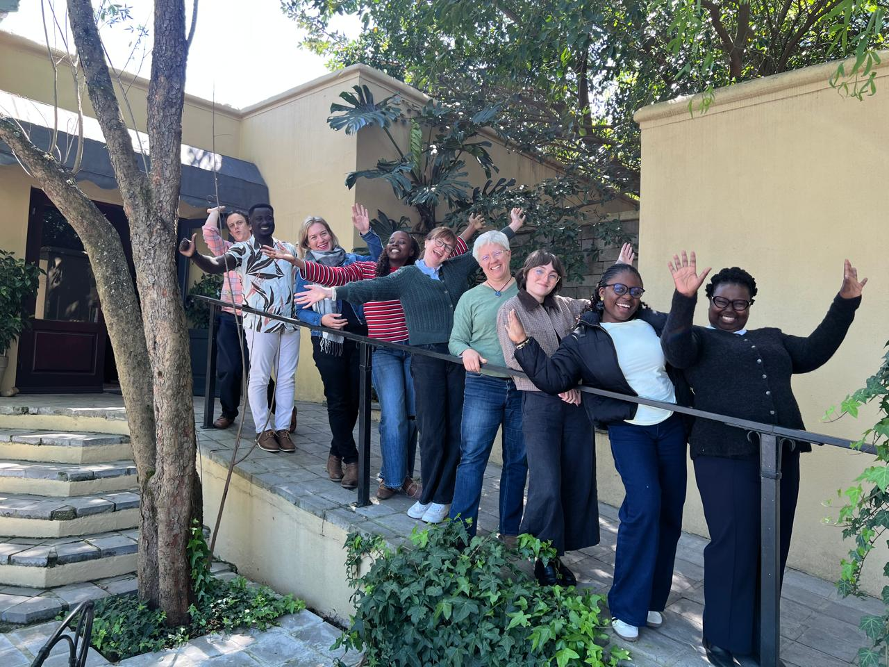

The MeTsi Modelling Consortium held its annual meeting in the Stellenbosch hills, bringing together mathematical modellers, epidemiologists and public health specialists from NICD, GCRO, MASHA, SACEMA and the London School of Hygiene and Tropical Medicine. The consortium explored and investigated how wastewater and environmental surveillance (WES), which detects traces of pathogen genetic material in wastewater from human settlements, could complement traditional disease surveillance and give population-level insights into disease epidemiology.
Researchers presented their ongoing modelling work on influenza, measles, hepatitis E, and hepatitis A. The project aims to build interpretive frameworks that combine clinical and wastewater data for stronger epidemiological modelling. The presentations highlighted the strong progress made across the consortium’s projects.

The meeting was a valuable opportunity for members to come together in person, share ideas and strengthen collaboration. The team left with renewed momentum and a shared enthusiasm for the next phase of the work.

Thanks to the Gates Foundation for funding this important research. 

