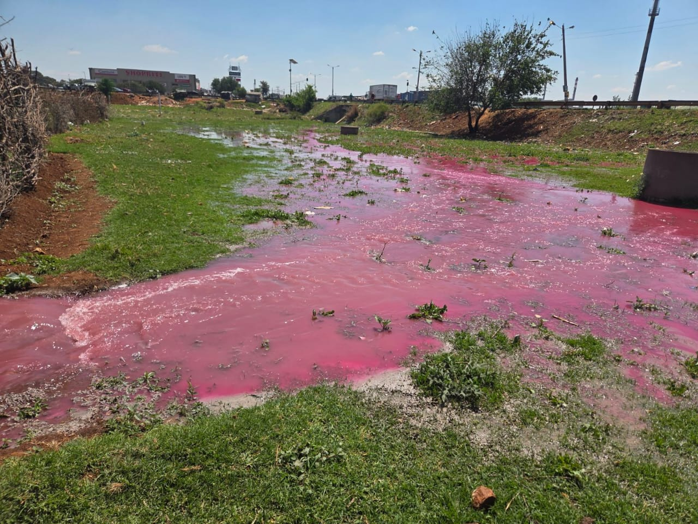

[Hovi et al](https://pubmed.ncbi.nlm.nih.gov/11561962/)  did a fascinating experiment where they spiked a wastewater system with polio vaccine in order to establish the relationship between detected polio concentration and the size of the inoculum. These data may be used to model population burden of disease from wastewater. 

We want to do the same thing with influenza virus. If we can put inactivated influenza virus into a sewer, and measure it downstream, we can use these data in our context to model burden of influenza disease based on wastewater levels. We set out to do this in one of our catchment sites. Last week we all gathered for a pre-briefing meeting at the inoculation site, and then moved on to the downstream sample collection sites. Vic Mabasa prepared his inoculum of influenza virus. We put it into the sewer with 18 litres of red tracer dye. 

Whilst the team was waiting downstream for the dye, our sample collectors reported that the field around them was turning pink, but the wastewater didn't show any sign of colour! What a disappointment! It turned out there was a blockage and leak upstream! 

We'll have to try again when the leak is repaired. But we learnt a lot in the process - next time will be smooth sailing! 

Thanks to the Gates Foundation for funding this important research. 

